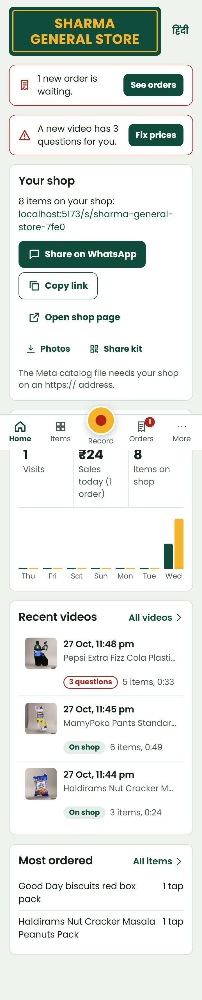
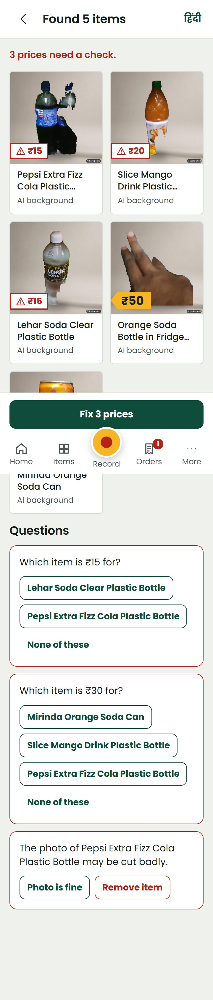
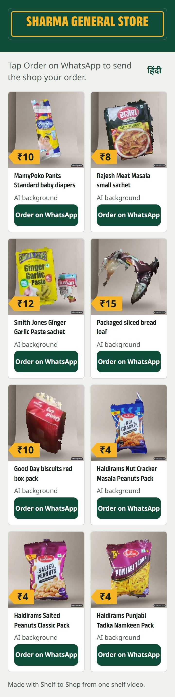
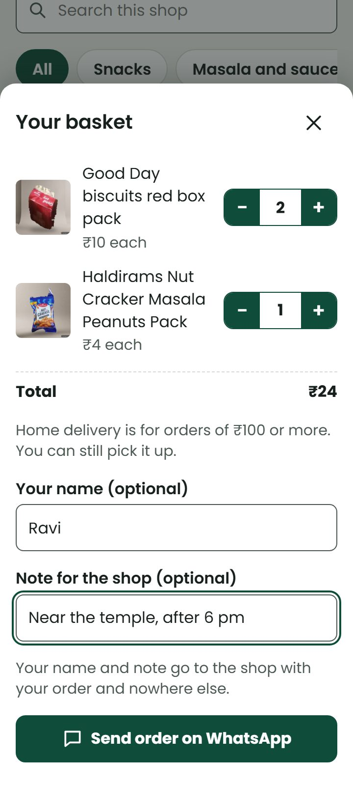
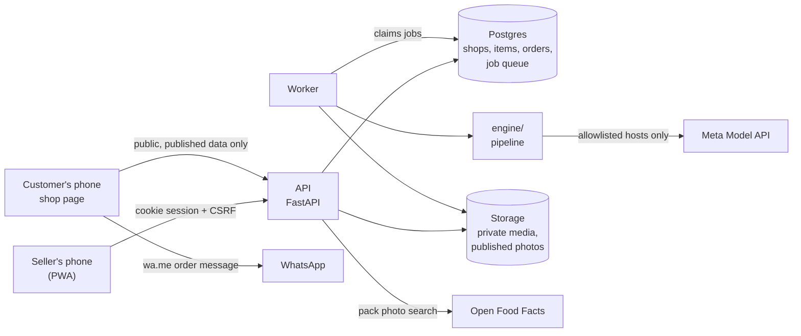
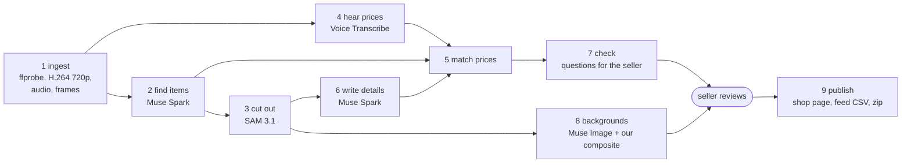

# Shelf-to-Shop

A shopkeeper films the shelf for under a minute, saying prices out loud ("ye neela wala 1200, cotton
wala 850"). Shelf-to-Shop turns that video into a shop that takes orders:

- **a shop page** on the phone, with a basket that sends one numbered order on WhatsApp,
- **a Meta catalog feed** (CSV) to upload once to Commerce Manager, which powers Instagram product tags
  and the WhatsApp catalog,
- **a zip of clean product photos**, with the item's own pixels untouched.

The seller checks every price before anything goes public. If the system is unsure, it asks a short
question ("Is this ₹4 or ₹5?") instead of guessing.

<p>




</p>

## The problem

- India has more than **7.3 crore** registered micro, small and medium enterprises, including 2.9 crore
  informal micro enterprises brought onto the Udyam Assist Platform
  ([Ministry of MSME, Year End Review 2025, via KNN India](https://knnindia.co.in/news/newsdetails/msme/msme-ministrys-year-end-review-2025-highlights-expansion-in-credit-skilling-digital-governance)).
- They already sell where their customers are: **97%** of over 10,000 retail MSMEs surveyed use WhatsApp
  or WhatsApp Business, while only 17% use point-of-sale software
  ([PayNearby MSME Digital Index 2024, via Entrepreneur India](https://india.entrepreneur.com/news-and-trends/whatsapp-and-whatsapp-business-dominate-msme-landscape-with/476232)).
- The tools for a proper catalog exist, but they are form-shaped: a WhatsApp Business catalog entry needs
  a price, description and product code typed in for each item
  ([WhatsApp, 2019](https://blog.whatsapp.com/introducing-catalogs-for-small-businesses)), and a Meta
  catalog feed needs a title, description, price, link and a square image per row. Interviews with
  small business owners in India found WhatsApp's formal business tools "more complex and costly" to
  adapt to than the plain app they started with
  ([De, CHI 2025](https://arxiv.org/abs/2502.10913)).

A kirana with 200 items, or a saree shop with a new lot every week, does not type 200 rows on a phone.
So the catalog never gets made, and customers keep asking "price kya hai?" one photo at a time.
Shelf-to-Shop starts from what the seller already does well: showing the stock and saying the price.

## Quickstart (local, no API key needed)

Needs Docker and `make` (Windows: Git Bash or `winget install ezwinports.make`).

```sh
git clone <this repo> && cd shelf-to-shop
make dev          # Postgres, the API with fake AI, and the web app
```

Open http://localhost:5173, type a shop name under **Start your own shop**, and upload any short video. The fake providers replay a
labelled synthetic clip (`evals/labels/synth_a.json`), so the whole flow works offline: processing,
review with questions, publish, the shop page and a WhatsApp basket order.

With the real Meta models, put `META_API_KEY` in `.env` (see `.env.example`) and run
`PROVIDERS=meta make dev`. A 30-second clip costs about $0.10.

Without Docker: `make setup`, then `make api` and `make web` in two terminals with
`WORKER_INLINE=true DEMO_LOGIN_ENABLED=true PROVIDERS=fake`. To try the in-app camera on a real phone you
need HTTPS: see [docs/runbook.md](docs/runbook.md#6-local-development).

Checks: `make check` (ruff, mypy strict, import boundaries, pytest), `make web-test` (tsc and vitest),
`make e2e` (Playwright, the seller's whole journey with fake providers).

## What the seller gets

| Screen | What it is for |
|---|---|
| Record | Rear camera, 60 s limit with a countdown, "Move slowly" and "Say each price", a mic level that says "Speak louder", torch. Or pick a video from the gallery (up to 10 minutes; choose which minute to use). Uploads resume after a dropped connection |
| Processing | The pipeline's steps as they finish; the seller can close the app |
| Review | Every item with its photo and price tag; questions only where the system is unsure; each price shows where it came from (the words heard, the time, the tag read) |
| Items | Stock and prices: sold out, MRP and offers, sections, pin, hide, bulk price changes, three ways to replace a weak photo (own photo, a better moment in the video, a pack photo from Open Food Facts) |
| Orders | Basket orders from the shop page: new, packed, delivered, paid |
| Home | Today's orders and sales, open questions, the shop link, and downloads of the Meta catalog file (CSV) and the photo zip |
| Share | Shop link, QR poster for the counter, a WhatsApp Status picture for any item |
| Settings | Language (English, Hindi), video retention, download all data, delete the shop |

English and Hindi throughout; Poppins covers both scripts. Designed for a budget Android phone in
sunlight: high contrast, large prices with Indian digit grouping (₹1,20,000), 48 px tap targets. The
reasoning is in [docs/design-plan.md](docs/design-plan.md).

## How it works



The job queue is a database table with leases (no Redis): a job is queued in the same transaction that
creates it, and a crashed worker's lease expires so the job is picked up again.

`engine/` is a self-contained package (an import-linter contract keeps it free of app code). Every stage
has pydantic input and output, is cached by a hash of its inputs and model versions, and can rerun on
its own:



### Which Meta model does what, and why

| Step | Model | Why |
|---|---|---|
| Find items, read price tags, pair each spoken price with the item on screen | **Muse Spark 1.3**, video with audio in one call | It watches and listens together, so "ye neela wala 1200" is tied to the blue item. Returns time ranges and boxes in a strict JSON schema |
| Cut out each item | **SAM 3.1**, prompted with the box Muse Spark found | A concept prompt ("saree") matched every fabric on a shelf in our spike; a box picks the one item. Masks are tight on folded textiles |
| Hear prices with timing | **Muse Voice Transcribe 1.0**, Hindi with English code-switching | It gives turn-level timing only, so we split the audio on pauses and transcribe each phrase; "ek hazaar do sau", "saadhe aath sau" and Devanagari digits are read by our own parser |
| Titles, category, colour, material, descriptions in English and Hindi | **Muse Spark 1.3**, text, minimal reasoning | Same strict structured output; minimal reasoning gave the same answers at about half the tokens |
| Clean background | **Muse Image 1.0** makes only an empty backdrop; we composite the original item pixels on top | Muse Image has no mask input, and an edit test changed 43% of the product's pixels. Compositing keeps them byte-identical (a test checks this) |

Prices are decided by our own matcher, not by one model's say-so: the spoken price (by time and by
words like "agla", "peeche", colours), Muse Spark's pairing and the printed tag are weighed together, and
every price keeps its evidence. A price said below the printed one (and not in doubt otherwise) is read
as a discount off the MRP; a price above it, two models hearing different numbers, two different spoken
prices, or a near tie between two items becomes a question.
Spike notes are in [spikes/RESULTS.md](spikes/RESULTS.md).

## Evals

<!-- evals:start -->
| Clip | Video | Items labelled | Items found | Recall | Precision | Prices right | Asked the seller | Wrong, not asked | Processing | Cost |
|---|---|---|---|---|---|---|---|---|---|---|
| real_kirana_a | 24 s | 3 | 3 | 100% | 100% | 3/3 | 0 | 0 | 120 s | $0.06 |
| real_kirana_b | 49 s | 7 | 7 | 100% | 100% | 6/6 | 0 | 0 | 227 s | $0.18 |
| real_kirana_c | 33 s | 5 | 7 | 100% | 71% | 5/5 | 0 | 0 | 164 s | $0.11 |
| synth_a | 32 s | 6 | 6 | 100% | 100% | 3/6 | 3 | 0 | 180 s | $0.10 |
| **All** | 138 s | 21 | 23 | 100% | 91% | 17/20 | 3 | 0 | 692 s | $0.45 |

*Prices right* counts labelled items that were found and have a price. *Asked the seller* became a question in Review instead of a guess. *Wrong, not asked* is the outcome that must not happen: a wrong price published without a question.

Estimated manual time saved: 17 items listed with the right price and a photo, at about 90 s each by hand, is **26 minutes**, for 11.5 minutes of processing nobody has to watch.

Seeded traps (price said before or after the item, two items of the same colour, a tag that disagrees with the spoken price, no price said): **5 of 5** ended with the right price or a question.

Notes, so the table is read for what it is:

- `real_kirana_*` are three 24-49 s clips of a kirana shelf, filmed and narrated in Hinglish by the
  seller, who confirmed every price. Their on-screen times came from an earlier detection run, so item
  recall on them is optimistic. The two extra items in `real_kirana_c` are real drinks on the shelf the
  seller did not price; the app asks for their prices.
- `synth_a` is a synthetic saree clip (Muse Image photos, text-to-speech narration) with exact timings and
  five seeded traps. Its three questions are real catches: "ek hazaar do sau" heard as 1002, "dedh
  hazaar" heard as 10,000, and an item with no price said.
- The first run of these clips found 20 of 21 items with no silent wrong price, but asked 12
  questions; the fixes that followed (a price below the printed one is a discount off MRP, no "which item?" when
  both items have that price) were made on these same clips, so this is a check, not a held-out test.
- Model answers vary between runs (on the first run Muse Spark paired fewer spoken prices on
  `synth_a`); the table is one run. Processing time is measured from India against the Meta Model API;
  the seller can close the app meanwhile. Cost is the Meta Model API list price of every call made.
<!-- evals:end -->

Run them with `uv run python evals/run_evals.py` (the videos are not in the repo; labels are in
[evals/labels](evals/labels), scoring rules in [evals/scoring.py](evals/scoring.py)).

## Security and privacy

- Every seller query is scoped to the seller's shop and tested across shops; the public page serves an
  allowlisted snapshot (no ids, emails, videos, costs or evidence).
- Uploads are checked by content and by ffprobe, re-encoded, and stored under random keys; ffmpeg runs
  without network access and with time and memory limits.
- Outbound HTTP goes only to allowlisted hosts. Text, audio and images from videos are passed to the
  models as data, never instructions; every answer must match a strict schema; the models cannot publish,
  pay or message anyone.
- CSP without `unsafe-inline`, HSTS, strict CORS, CSRF tokens, rate limits on public and seller actions,
  structured logs with personal data scrubbed, an audit log.
- Shelf videos are deleted after the retention period (default 7 days); customer names on orders after 90
  days. Sellers can download or delete everything from Settings. AI backgrounds are labelled in the image
  metadata (IPTC `compositeSynthetic`) and on the page.
- CI: gitleaks (full history), pip-audit, npm audit, Semgrep, mypy strict, import boundaries, Dependabot.

Details and the honest gaps: [docs/security.md](docs/security.md) (OWASP ASVS 5.0 L2 mapping) and
[docs/privacy.md](docs/privacy.md) (DPDP Act). Deploying and incidents: [docs/runbook.md](docs/runbook.md).

## Limitations

- **Sign-in is a demo sign-in** (flag-gated, refused in production config). Email one-time codes and
  refresh-token rotation are designed but not built.
- Photos live on the server's disk; moving published photos to R2 with signed URLs is not done.
- The per-job spend cap is enforced; the daily caps across jobs are not yet.
- Muse Spark Open on Baseten for the text-only step is configured but not wired up; all steps use the Meta
  Model API.
- The feed follows Meta's catalog spec and is validated by tests, but has not yet been through a real
  Commerce Manager upload, which is also what settles whether Meta accepts our shop domain as the
  product link.
- The SocialPulse integration mode (`APP_MODE=socialpulse`: a tool API for the Phoenix assistant, signed
  webhooks) is designed in the build plan but not built.
- Eval clips are few and short; numbers above are a sanity check, not a benchmark.

## Roadmap

1. Email one-time-code sign-in, then a Capacitor Android shell around the same web app.
2. Commerce Manager upload of a real feed; scheduled feed URL instead of a one-time CSV.
3. More clips from real shops (textiles, footwear, handicrafts) and a larger eval set.
4. Daily spend caps, R2 storage for published photos, C2PA content credentials once a trusted signing
   certificate is practical.
5. SocialPulse mode: versioned tool API with manifest, API keys with scopes, HMAC request signing, signed
   webhooks, and a review link so the seller still approves every publish.

## Built during the hackathon (Oct 27 – Nov 4, 2026)

This entire repository was built during the Meta Global AI Developer Hackathon build period, Startup
track: every line of code, prompt, design and document. Nothing was copied from another project. Fonts and
libraries are third-party open source, listed in [NOTICE](NOTICE). Progress, day by day, is in
[PROGRESS.md](PROGRESS.md).

Shelf-to-Shop runs on its own (`APP_MODE=standalone`, the default). An optional `socialpulse` mode,
selected by configuration rather than a fork, is planned so that SocialPulse's assistant Phoenix can drive
the same engine as a tool; Shelf-to-Shop would still do all of the AI work and the seller would still
approve every publish.

## Licence

Apache-2.0. See [LICENSE](LICENSE) and [NOTICE](NOTICE).
